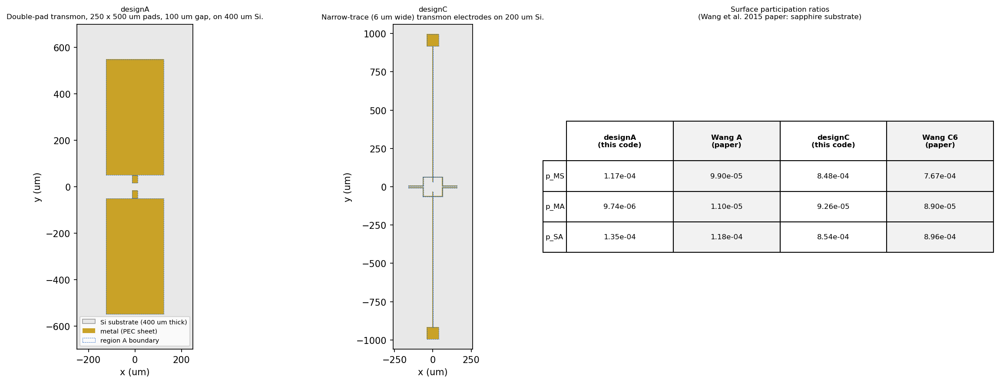

# SPR tutorial: transmon surface participation (Wang et al. 2015)

This tutorial computes the surface participation ratios (SPR) of a transmon and
the Q / T1 limit set by lossy surface layers. It follows

> C. Wang *et al.* (Schoelkopf group), "Surface participation and dielectric loss in
> superconducting qubits", *Appl. Phys. Lett.* **107**, 162601 (2015).

The geometry, materials and Fields Calculator expressions come from the Ansys
project `transmon_spr.aedt` (AEDT 2024 R1).

| File | Contents |
|---|---|
| `transmon_design.py` | Geometry, materials, interface-layer assumptions and simulation settings for the two HFSS designs and the 2D edge model. Run it to draw `transmon_layouts.png`. |
| `spr_calculation.py` | Prefactors, total energy, participation ratios, Q and T1. Running it first checks the prefactors against the constants in the Ansys project. |
| `transmon_ansys.py` | Builds either HFSS design (or the 2D edge model) through PyAEDT, solves it, and writes the \|E\|² integrals to `data/ansys_<design>_field_integrals.json` (edge factors to `data/ansys_edge2d_factors.json`), which `spr_calculation.py` loads automatically. |
| `data/` | Integrals from the full-convergence runs of `designA`, `designC` and the 2D edge model. |
| `transmon_layouts.png` | Layouts drawn by `transmon_design.py`, with a table of p_MS, p_MA and p_SA for each design next to the paper's values. |

```bash
python transmon_design.py     # prints the designs, saves transmon_layouts.png
python spr_calculation.py     # prefactor check + results for every design with integrals

conda activate quantum-metal-env              # PyAEDT + AEDT 2024 R1
python transmon_ansys.py designA --quick         # build + solve + extract, coarse convergence
python transmon_ansys.py designC --cores 32      # full convergence (30 passes, delta S 0.001)
python transmon_ansys.py edge2d --cores 32       # 2D edge model -> F_MS, F_MA, F_SA (~4 h)
python transmon_ansys.py designA --no-solve      # just build it and look
```

The design and calculation files need only Python 3.10+ (`matplotlib` for the
plot). `transmon_ansys.py` also needs PyAEDT (`pip install pyaedt`) and a local AEDT.
It opens AEDT graphically and leaves the window open (`--non-graphical` for batch
runs). Projects are written to `../../SPR_testing/SPR_tutorial/ansys_runs/`, outside
the repository.



## The designs in `transmon_spr.aedt`

| Ansys design | Geometry | Substrate | What its Fields Calculator holds |
|---|---|---|---|
| `designA` | 250 × 500 µm pads, 100 µm gap, 25 × 35 µm leads | Si, 500 × 1400 × 400 µm | Raw \|E\|² integrals: MA / MS interior and perimeter, SA, silicon and vacuum volumes, energy participation ratios |
| `designC` | 6 µm wide traces (stem, crossbar, legs, feet), 80 µm end squares | Si, 520 × 2120 × 200 µm | The full Wang calculation with prefactors written in: `pMA_interior`, `pMS_interior`, `pMA_perimeter`, `pMS_perimeter` |
| `Maxwell2DDesign1` | 2D cross-section of one metal edge | Si, 60 × 30 µm | Edge factors `Fms`, `Fma` |

Both HFSS designs are driven (HFSS Terminal Network) at 5 GHz, with a
50 Ω lumped port across the junction and the metal as perfect-E sheets.

## Method

### 1. Total electric energy (3D)

With ε₀ dropped (it cancels in every ratio):

$$U_\text{tot} = \tfrac12\int_\text{vac}|E|^2\,dV + \tfrac12\,\varepsilon_\text{Si}\int_\text{Si}|E|^2\,dV$$

With ε_Si = 11.9, the silicon weight is 5.95, which matches `total_energy` in `designC`.

### 2. Energy in each thin lossy layer

Each interface is a layer of thickness *t* = 3 nm and ε = 10, too thin to mesh in 3D.
The field is sampled on a sheet 1 nm from the metal, and the boundary conditions
give the field inside the layer:

| Interface | Field sampled in | Field inside the layer | Prefactor on ∫\|E\|²dA | Value |
|---|---|---|---|---|
| MA (metal–air) | vacuum, normal to metal | E_vac / ε_MA | t / (2 ε_MA) | 1.5 × 10⁻¹⁰ m |
| MS (metal–substrate) | substrate, normal to metal | ε_Si E_Si / ε_MS | t ε_Si² / (2 ε_MS) | 2.124 × 10⁻⁸ m |
| SA (substrate–air) | vacuum | E∥ continuous, E⊥ / ε_SA | t ε_SA / 2 (∥), t / (2 ε_SA) (⊥) | 1.5 × 10⁻⁸ m, 1.5 × 10⁻¹⁰ m |

$$p_i = \frac{k_i \int_i |E|^2\,dA}{U_\text{tot}}$$

### 3. Edge correction (2D)

The field diverges at the metal edge, and the 3D mesh cannot resolve the last
fraction of a micron. Each metal sheet is therefore split by distance from the edge:

* **region A**: more than 1 µm inside the edge, taken from 3D as is
* **region B**: 0.5–1 µm from the edge, taken from 3D and scaled by F
* **region C**: the last 0.5 µm (plus, for MA, the 50 nm side wall), only resolved in 2D

`Maxwell2DDesign1` is an electrostatic cross-section: a 30 µm half-strip,
50 nm thick, 1 V, with 3 nm ε = 10 layers meshed at 3 nm. It gives

$$F = \frac{U_B + U_C}{U_B}, \qquad F_\text{MS} = 8.891,\quad F_\text{MA} = 166.6$$

so that

$$p_\text{MA} = \frac{k_\text{MA}\left(I_{\text{MA},A} + F_\text{MA}\, I_{\text{MA},B}\right)}{U_\text{tot}}$$

and the same for MS. These F values were back-calculated from the perimeter
coefficients typed into `designC`'s calculator (2.498325 × 10⁻⁸ and
1.88856 × 10⁻⁷). They are the 2D results that were used in the study.

The original study had no SA edge factor. `transmon_ansys.py edge2d` rebuilds the 2D
model with an SA layer split the same way (C: 0–0.5 µm from the edge, B: 0.5–1 µm)
and gives **F_SA = 10.55**. It also gives F_MS = 9.08 (original: 8.89) and
F_MA = 106 (original: 167). F_MA is mostly the side-wall layer at the singular
metal corner divided by the small region-B energy, so it is mesh-sensitive.
`spr_calculation.py` keeps the study's F_MS and F_MA and takes F_SA from the rebuild.

### 4. Dielectric loss

$$\frac1Q = \sum_i p_i \tan\delta_i, \qquad T_1 = \frac{Q}{2\pi f}$$

## Getting the field integrals from Ansys

### Automatically: `transmon_ansys.py`

This script rebuilds a design from `transmon_design.py` in a new project
(`transmon_<design>.aedt`) and solves it. It then evaluates these integrals in the
Fields Calculator:

| Sheet / volume | Where | Integral |
|---|---|---|
| `substrate`, `Region` | volumes | ∫\|E\|² dV |
| `MA_A`, `MA_B` | 1 nm above the metal, region A / B | ∫\|E\|² dA |
| `MS_A`, `MS_B` | 1 nm below the metal, region A / B | ∫\|E\|² dA |
| `SA_A`, `SA_B` | 1 nm above bare Si, > 1 µm / 0.5–1 µm from metal | ∫\|E\|² dA and ∫\|E_z\|² dA |

The \|E_z\|² integral lets the SA layer be weighted exactly (tangential and normal
parts separately), and `SA_B` is scaled by F_SA.

Differences from `transmon_spr.aedt`:
* **Solution type:** Modal instead of Terminal Network. With one 50 Ω port the fields are identical.
* **One sheet per interface and region,** both electrodes together.
* **Mesh and sheets follow each original design.** designA: MA / MS sheets are model
  objects and the metal has a 3 µm length mesh. With non-model sheets designA's
  region B came out 2× too low. designC: non-model sheets and a 5 µm length mesh. A
  1 nm model layer in its 440 µm tall model exceeds the mesher's 10⁵ stack-ratio limit.
  The per-design settings are `model_sheets` and `edge_mesh_um` in `transmon_design.py`.

### Results (full convergence: 30 passes, ΔS 0.001)

Rebuild vs the original project, both normalised to the same substrate energy:

| Quantity | designA original | designA rebuild | designC original | designC rebuild |
|---|---|---|---|---|
| Substrate EPR | 0.9218 | 0.9218 | 0.8108 | 0.8105 |
| MA interior (A) | 1 | 0.99 | 1 | 1.00 |
| MA perimeter (B) | 1 | 1.09 | 1 | 1.01 |
| MS interior (A) | 1 | 1.02 | 1 | 1.05 |
| MS perimeter (B) | 1 | 1.09 | (not saved) | |
| SA (> 1 µm) | 1 | 0.97 | (no SA sheet) | |

designC against Wang et al. Table S1, C6 (g = w = 6 µm, sapphire, so not identical):

| | designC (this code) | Paper C6 |
|---|---|---|
| p_MS | 8.5 × 10⁻⁴ | 7.7 × 10⁻⁴ |
| p_MA | 9.3 × 10⁻⁵ | 8.9 × 10⁻⁵ |
| p_SA | 8.5 × 10⁻⁴ | 9.0 × 10⁻⁴ |

designA (wide pads) gives p_MS = 1.2 × 10⁻⁴, p_MA = 9.7 × 10⁻⁶, p_SA = 1.3 × 10⁻⁴, the
same order as the paper's large-pad design A (MS 0.99, SA 1.18, MA 0.11, all × 10⁻⁴).

### By hand, from `transmon_spr.aedt`

Open `transmon_spr.aedt`, open the design, then **Fields → Calculator**. The
named expressions are already there. Evaluate each one on `Setup1 : LastAdaptive`
and enter the *plain* \|E\|² integrals in `FIELD_INTEGRALS` in
`spr_calculation.py` (leave out the 0.5 and ε factors; the code adds them):

| `FieldIntegrals` field | `designA` expression | `designC` expression |
|---|---|---|
| `substrate_volume` | `silicon_energy` | `silicon_energy` |
| `vacuum_volume` | `vacuum_energy` **÷ 0.5** (it already includes the ½) | `vacuum_energy` |
| `MA_A` | `MA_interior_energy` | `MA_energy_total` |
| `MA_B` | `MA_B_perimeter` | `MA_perimeter_energy` |
| `MS_A` | `MS_interior_energy` | `MS_total_energy` |
| `MS_B` | `MS_B_perimeter_energy` | `MS_B_energy` |
| `SA_A` | `SA_energy` | (no SA sheet) |

## What has been checked

* `python spr_calculation.py` reproduces `designC`'s interior prefactors
  (1.5 × 10⁻¹⁰ and 2.12415 × 10⁻⁸) and the silicon weight 5.95 from
  t = 3 nm, ε = 10, ε_Si = 11.9.
* The rebuilt designA and designC reproduce the original solutions (table above).
* designC reproduces the paper's C6 participation ratios to within about 10 %.
* The rebuilt 2D edge model reproduces F_MS to within 2 %.

## Still open

* **F_MA:** the 2D rerun gives 106 against the study's 167 (mesh-sensitive corner term).
  The study's value reproduces the paper's p_MA better, so it is kept.
* **Loss tangents** in `LOSS_TANGENTS` are placeholders: 2.6 × 10⁻³ / 2.3 = 1.13 × 10⁻³ for every
  interface (the paper's combined constraint split equally), 10⁻⁷ for Si.
* Which HFSS design produced the final numbers (`designA` or `designC`).
