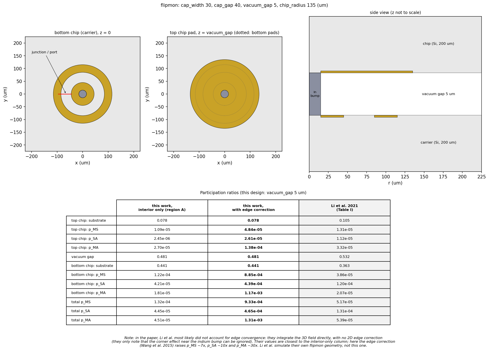
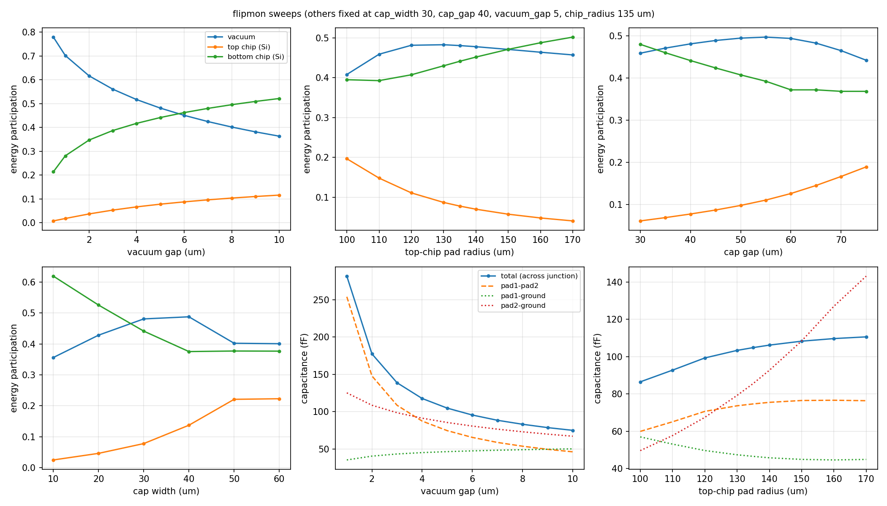

# Flipmon surface participation

This folder holds the surface participation ratio (SPR) and dielectric loss study of a flip-chip
transmon (the "flipmon"). It uses the same method as the transmon tutorial in
[`../SPR_tutorial`](../SPR_tutorial):

> C. Wang *et al.*, "Surface participation and dielectric loss in superconducting qubits",
> *Appl. Phys. Lett.* **107**, 162601 (2015).

| File | Contents |
|---|---|
| `flipmon_design.py` | Geometry, materials, interface layers, Fields Calculator object names, 2D edge model, sweep ranges. Run it to draw `flipmon_layout.png` (layout plus a table of p_MS, p_SA, p_MA per chip, compared with Li *et al.* 2021). |
| `flipmon_spr_calculation.py` | Reproduces the spreadsheet calculation, recomputes it with consistent formulas, plots the sweeps, and reads Ansys results if any exist. |
| `flipmon_ansys.py` | Builds the design in HFSS through PyAEDT, solves it, and writes the \|E\|² integrals to `data/ansys_field_integrals.json`. |
| `data/*.csv` | Energy participation (EPR) and capacitance sweeps copied from the `flipmon` tab of `spr graphs.xlsx`. |

```bash
python flipmon_design.py              # layout figure
python flipmon_spr_calculation.py     # sheet reproduction, corrected SPR, sweep plots

conda activate quantum-metal-env      # PyAEDT + AEDT 2024 R1
python flipmon_ansys.py --quick       # build + solve + extract (about a minute)
python flipmon_ansys.py               # full convergence (30 passes, delta S 0.001)
python flipmon_spr_calculation.py     # now also prints SPR from the fresh extraction
```



The table compares the full Ansys rebuild (`data/ansys_field_integrals.json`) with
Table I of X. Li *et al.*, "Vacuum-gap transmon qubits realized using flip-chip
technology", *Appl. Phys. Lett.* **119**, 184003 (2021),
[arXiv:2106.00341](https://arxiv.org/abs/2106.00341). Li *et al.* use the same 3 nm,
ε = 10 layers and a 5 µm gap, but their own geometry. They most likely did not
account for edge convergence: they integrate the 3D field directly, with no 2D edge
correction, and only note that the corner effect near the indium bump can be ignored.
Their values sit close to the interior-only (region A) column. With the Wang *et al.*
edge correction, p_MS rises about 7×, p_SA about 10× and p_MA about 30×.

## Sources

| Source | What it holds |
|---|---|
| `old_flipmon_design/flipmon_spr - Copy.aedt`, design `flipmon` | 3D HFSS model with every interface sheet and the full Wang calculation in its Fields Calculator. The saved variables (cap_width 30, cap_gap 40, vacuum_gap 5, chip_radius 135 µm) are the baseline point of every sweep in the spreadsheet. |
| same project, `Q3DDesign1` | Capacitance matrix (pad 1, pad 2, ground) behind `data/capacitance_*.csv`. |
| `FLIPMON_large_top_vacuum.aedt` | 2D electrostatic edge model with the top chip overhead, vacuum gap swept from 1 to 10 µm. Gives `Fms`, `Fma`, `Fsa`. |
| `FLIPMON_equal_top_vacuum.aedt` | The same 2D model in a smaller simulation box. |
| `spr graphs.xlsx`, tab `calculation flipmon` | Field integrals at the baseline point and the SPR arithmetic. |
| `spr graphs.xlsx`, tab `flipmon` | EPR sweeps, capacitance sweeps, F_MS vs vacuum gap. |

The `Z:` copy of `flipmon_spr - Copy.aedt` has the same geometry and calculator
expressions as the `E:` copy. It only adds a parametric sweep.

## Geometry

* **Bottom chip (carrier):** inner pad, an annulus from cap_width/2 to 1.5·cap_width.
  Outer pad, an annulus of width cap_width starting cap_gap further out.
  The junction and lumped port sit on the −x axis.
* **Top chip:** a pad of radius chip_radius on its underside, facing the carrier across the vacuum gap.
* **Indium bump** (r = cap_width/2): joins the inner pad and the top-chip pad into one electrode.

The total capacitance across the junction is C₁₂ + C₁g·C₂g / (C₁g + C₂g), the same
formula the sheet uses.

## Sweeps

Energy participation of vacuum, top chip and bottom chip, and the capacitances,
against each parameter. The other parameters stay at the baseline.



## Calculation

$$U_\text{tot} = \tfrac12\!\int_\text{vac}\!|E|^2 + \tfrac{\varepsilon_\text{Si}}{2}\!\int_\text{carrier+chip}\!|E|^2$$

$$p_\text{MA} = \frac{t}{2\varepsilon_\text{MA}}\frac{I_\text{int} + F_\text{MA} I_\text{per}}{U_\text{tot}},\quad
p_\text{MS} = \frac{t\,\varepsilon_\text{Si}^2}{2\varepsilon_\text{MS}}\frac{I_\text{int} + F_\text{MS} I_\text{per}}{U_\text{tot}},\quad
p_\text{SA} = \frac{t}{2\varepsilon_\text{SA}}\frac{I_\text{int} + F_\text{SA} I_\text{per}}{U_\text{tot}}$$

Each term is evaluated separately for the bottom and top chip, with t = 3 nm and
ε = 10. The edge factors are F_MS = 8.389, F_SA = 10.85, and F_MA = 611.28
(Ansys calculator) or 616.28 (sheet).

### Results at the baseline point (spreadsheet integrals)

| | Sheet as written | Consistent formulas (same F) |
|---|---|---|
| p_MA, bottom + top | 4.56 × 10⁻⁴ | 6.21 × 10⁻⁴ |
| p_MS, bottom + top | 2.06 × 10⁻⁵ | 6.00 × 10⁻⁵ |
| substrate / vacuum EPR | | 0.283 / 0.717 |

`python flipmon_spr_calculation.py` reproduces all 11 cached cells of
`calculation flipmon` exactly. It then recomputes them with the formulas above.
The difference comes from these spreadsheet issues:

1. **MS perimeter (E7, E13):** the ε_Si² factor is missing. The MS interior
   formula (E4, E10) and the Ansys coefficient 1.78196 × 10⁻⁷ both include it.
   This makes MS perimeter 141.6× too small.
2. **MA perimeter (H7, H13):** divides by the vacuum energy (B4) instead of the total energy (B5).
3. **F_MA:** the sheet has 616.28, but the Ansys coefficient implies 611.28.
4. **Ansys typo:** `bottom_MS_interior` uses 2.121415 × 10⁻⁸; every other MS prefactor is 2.12415 × 10⁻⁸.
5. **F_MS depends on the vacuum gap** (8.10 at 2 µm to 8.60 at 8 µm, `data/fms_vs_vacuum_gap.csv`).
   The sheet labels the fixed 8.483 as "incorrect", and uses 8.389, which is not in that table.
6. **Region B vs perimeter band:** the 2D model defines region B as 0.5–1 µm from the
   edge, but the 3D perimeter sheets cover 0–1 µm. Applying F to a 0–1 µm band
   double-counts the last 0.5 µm. `flipmon_ansys.py --band 0.5` uses the Wang et al. definition.
7. **SA sheet side:** the original SA sheets are 1 nm *inside* the silicon, while the
   SA prefactor assumes a vacuum-side normal field. `flipmon_ansys.py` samples SA on
   the vacuum side and extracts \|E_z\|², so the normal and tangential parts are weighted correctly.

**Which run the sheet's integrals came from is unclear.** They give a vacuum
EPR of 0.717. The baseline sweep point is 0.481, and the closest sweep row is
vacuum_gap = 1 µm (0.702). The integrals may have come from a smaller-gap run.

The loss tangents in `LOSS_TANGENTS` (2 × 10⁻³ interfaces, 10⁻⁷ Si) are
placeholders, so the Q and T1 values printed are illustrative. Cell D19 of the
sheet holds an unlabelled 0.0022 that may have been meant as tan δ.

## Running in Ansys

`flipmon_ansys.py` rebuilds the project from `flipmon_design.py`, so a sweep is
just a loop over its command-line options (`--cap-width`, `--cap-gap`,
`--vacuum-gap`, `--chip-radius`). Differences from the original project:

* **Solution type:** Modal instead of Terminal Network. With one port the fields are identical.
* **Sampling sheets are non-model,** so the 1 nm offsets do not force a nanometre mesh.
  The original mixed model and non-model sheets.
* **The top-chip MA perimeter band is 1 µm wide** (inside the edge). The original was
  2 µm and extended 1 µm past the metal.

`--quick` (8 passes, ΔS = 0.02) is only a functional check. Use the defaults for numbers you intend to quote.

### Check against the manual project (baseline point)

Full run: `python flipmon_ansys.py --cores 16` (cap_width 30, cap_gap 40, gap 5,
R 135 µm, band 0; 30 passes, ΔS 0.001; 1 h 20 min solve). The manual values are the
named expressions in the original `flipmon` design, evaluated on its saved solution
(30 passes). Both use the same prefactors (MA 1.5e-10, MS 2.12415e-8, F_MS 8.389,
F_MA 611.28).

| Quantity | Manual project | Rebuild | Ratio |
|---|---|---|---|
| Vacuum EPR | 0.4809 | 0.4791 | 1.00 |
| Substrate EPR (chip + carrier) | 0.5191 | 0.5209 | 1.00 |
| bottom MA interior | 1.72e-5 | 1.81e-5 | 1.05 |
| bottom MA perimeter | 1.26e-3 | 1.15e-3 | 0.91 |
| bottom MS perimeter | 7.02e-4 | 7.63e-4 | 1.09 |
| top MA interior | 2.68e-5 | 2.70e-5 | 1.01 |
| top MA perimeter | 2.53e-4 | 1.11e-4 | 0.44 (band width, see below) |
| top MS perimeter | 4.81e-5 | 3.75e-5 | 0.78 |
| bottom MS interior | 6.49e-5 | 1.22e-4 | 1.87 |
| top MS interior | 5.4e-6 | 1.09e-5 | 2.0 |
| bottom SA (interior + perimeter) | 1.00e-5 | 4.39e-4 | 44 (prefactor, see below) |
| **MA total** | 1.56e-3 | 1.31e-3 | 0.84 |
| **MS total** | 8.20e-4 | 9.33e-4 | 1.14 |

* **EPR and the dominant terms agree.** These are the EPR, the bottom-pad MA and the
  MS perimeter terms. The rebuild reproduces the manual project.
* **Top MA perimeter:** the manual sheet is 2 µm wide (R − 1 to R + 1 µm); the rebuild
  uses 1 µm inside the edge. The manual band half outside the metal is really SA area.
* **MS interiors are about 2× higher in the rebuild,** although the sheets sit in the same
  place (1 nm below the metal, 1 µm in from the outer edge) and the MA interiors on the
  same pads agree. This is the weak field under the pad interior, so it is
  mesh-sensitive. It is 8 % of p_MS in the manual run and 13 % in the rebuild. Not resolved.
* **SA:** the manual expressions multiply all of |E|² by t/(2ε) = 1.5e-10, the normal-field
  prefactor, so they count only the normal part of the field. The rebuild integrates |E_z|²
  separately and weights the tangential part by tε/2 = 1.5e-8, as in Wang et al. The
  tangential field on the bare carrier is small but carries a 100× larger weight, so the
  manual p_SA is a lower bound.
