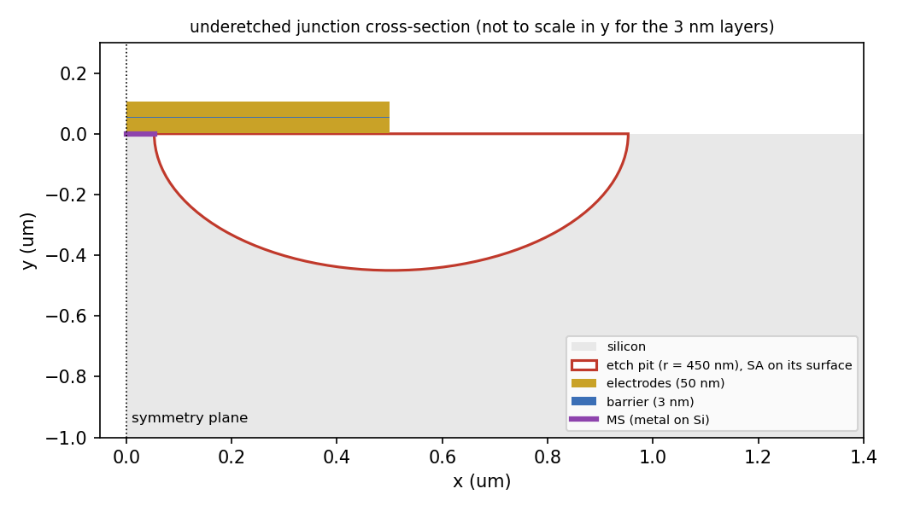
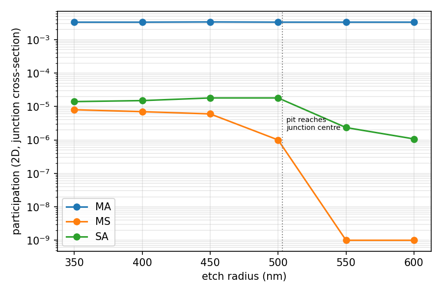

# Junction underetch

This folder shows how the surface participation *at the mergemon junction*
changes when the silicon under the junction edge is etched away. It is a 2D
electrostatic cross-section, so the junction is treated as infinitely long.

* **Source project:** `E:\Nimisha\Mergemon\mergemon_3D_SPR.aedt`, design `2d_etched_edges`
  (Maxwell 2D, electrostatic, XY).
* **Spreadsheet:** `spr graphs.xlsx`, Mergemon tab, section "2d junction simulation",
  copied to `data/underetch_spr.csv`.

| File | Contents |
|---|---|
| `underetch_design.py` | Cross-section geometry, materials, boundaries, mesh and sweep, taken from the project. Run it for `underetch_cross_section.png`. |
| `underetch_calculation.py` | Table and plot (`underetch_spr.png`) of p_MS, p_MA, p_SA and the junction EPR against etch radius. |

```bash
python underetch_design.py
python underetch_calculation.py
```



## Model

* **Junction:** two 50 nm electrodes, 0.5 µm half-width, with a 3 nm Al₂O₃ barrier
  between them. One electrode is at 1 V and the other at 0 V.
* **Underetch:** a circular pit of radius `etch_radius`, centred on the metal edge,
  is removed from the silicon.
* **Lossy layers:** every interface is a real 3 nm, ε = 10 layer meshed at 3 nm,
  so each participation is simply layer energy / total energy:
  * MS under the metal, only where it still rests on silicon;
  * MA on the top, the side wall, and the underside exposed by the etch;
  * SA lining the pit.
* **Boundaries:** even symmetry at the junction centre, odd symmetry at the far side.



| Etch radius (nm) | p_MS | p_MA | p_SA | Junction EPR |
|---|---|---|---|---|
| 350 | 8e-6 | 3.32e-3 | 1.4e-5 | 0.9938 |
| 400 | 7e-6 | 3.32e-3 | 1.5e-5 | 0.9941 |
| 450 | 6e-6 | 3.38e-3 | 1.8e-5 | 0.9944 |
| 500 | 1e-6 | 3.33e-3 | 1.8e-5 | 0.9944 |
| 550 | 0 | 3.33e-3 | 2.3e-6 | 0.9951 |
| 600 | 0 | 3.33e-3 | 1.1e-6 | 0.9952 |

MS drops to zero once the pit reaches the junction centre (etch radius ≥ 503 nm),
because no metal is left on silicon. SA also falls beyond that point. MA stays
at about 3.3 × 10⁻³ throughout.

The project's parametric sweep covers 350–500 nm. The 550 and 600 nm rows come
from the spreadsheet only.
