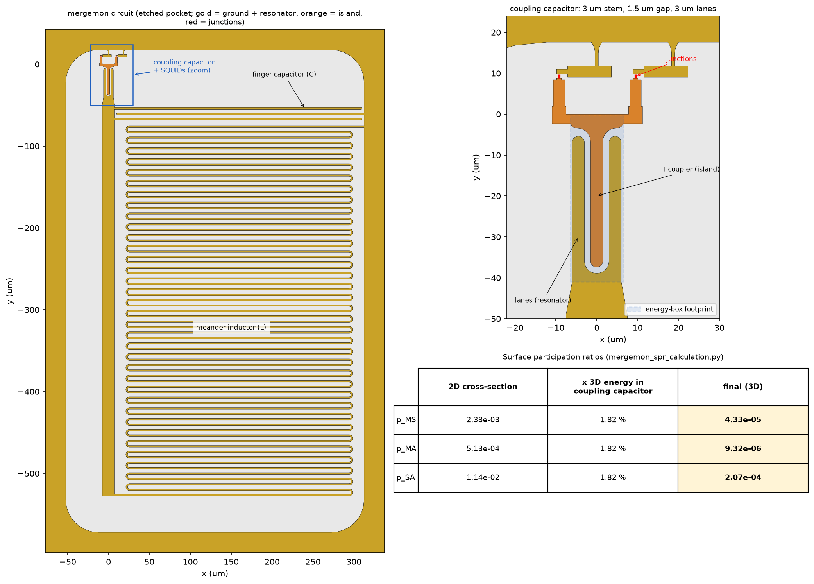

# Mergemon surface participation

The mergemon's surface participation was estimated with a different method from
the transmon and flipmon folders. It weights a 2D cross-section SPR by the
fraction of the 3D mode energy that sits in the coupling capacitor. This
estimate turned out to be accurate enough: it was confirmed by experiment.

## Why not Wang et al.

[Wang *et al.*, APL **107**, 162601 (2015)](https://arxiv.org/abs/1509.01854)
(the method in [`SPR_tutorial`](../../SPR_tutorial)) splits each conductor into
two parts:
* an **interior region**, more than x₀ = 1 µm from any edge, taken from the 3D simulation;
* an **edge band**, corrected with a 2D simulation.

That only works when x₀ is much smaller than the conductor width and the gaps.
The paper's electrodes are 10–500 µm across.

The mergemon coupling capacitor is much smaller. Its T stem is 3 µm wide, with
1.5–2 µm gaps to the surrounding lanes, so almost none of it counts as "interior"
(note in the spreadsheet: *"the interior region is 3um"*). The interior/edge
split stops being meaningful at this scale; as a rough guide it needs features
of at least about 5 µm. So the mergemon uses the cruder estimate below.

## Files

| File | Contents |
|---|---|
| `mergemon_design.py` | Parameterised layout (qiskit-metal), copied from `Z:\Nimisha\Mergemon`. It defines the coupling-capacitor geometry the energy boxes are built around. Run it (in `quantum-metal-env`) to draw `mergemon_layout.png`. |
| `mergemon_energy_boxes.py` | Adds the four coupling-capacitor energy boxes and their Fields Calculator expressions to the 3D HFSS project. Runs in AEDT through PyAEDT; nothing is re-solved. |
| `mergemon_spr_calculation.py` | Reproduces the "3d mergemon simulation" section of the spreadsheet: EPRs, capacitor energy fraction, weighted SPR. |
| `mergemon_layout.png` | The circuit, a zoom into the coupling capacitor with the energy-box footprint, and the table of final p_MS, p_MA, p_SA. |
| [`../JJ underetch/`](../JJ%20underetch) | 2D junction cross-section: participation against underetch radius. |

The AEDT projects are not in the repository (about 19 MB each). By default
`mergemon_energy_boxes.py` looks for them in `../../../SPR_testing/mergemon/`:
* `full_mergemon_resonator_design.aedt`, a copy of `E:\Nimisha\Mergemon\full_mergemon_resonator_design.aedt` (no results);
* `full_mergemon_resonator_design_energy_boxes.aedt`, the same project with the boxes and expressions added.

```bash
python mergemon_spr_calculation.py            # plain Python, no Ansys needed

conda activate quantum-metal-env              # PyAEDT + AEDT 2024 R1
python mergemon_energy_boxes.py               # rebuilds the *_energy_boxes.aedt (window stays open)
python mergemon_design.py                     # layout figure + SPR table -> mergemon_layout.png
```



## Method

1. **3D eigenmode.** Source: `full_mergemon_resonator_design.aedt`, `HFSSDesign1`,
   with Lj = 36 nH and Cj = 45 fF per junction. The mode's electric energy splits
   into three parts:
   * the SOI silicon (`Box1` device layer + `Box2` handle): 1.1471;
   * the vacuum: 0.8336;
   * the two junctions, ½·(2 × 45 fF)·V²: 59.24.

   The total is 61.22, so the junction EPR is 96.8%.
2. **Coupling-capacitor energy.** Four boxes around the capacitor:

   | Box | z range | Energy |
   |---|---|---|
   | `cc_vac_top` | metal plane → top of the solved region | 0.5629 / 2 |
   | `cc_top_substrate` | SOI device layer, 0 → −0.22 µm | 0.9981 / 2 |
   | `cc_vac_below` | etched vacuum gap, −0.22 → −3.22 µm | 0.33 |
   | `cc_bottom_substrate` | handle, −3.22 µm → bottom of the substrate | 0.0018 |

   Together they hold 1.1123, which is **1.82%** of the mode energy.
3. **2D cross-section.** Source: `E:\Nimisha\Mergemon\2d_designs.aedt`, design
   `coupling_capacitor`. It is a Maxwell 2D electrostatic model:
   * a 3 µm stem at 1 V, with two 3 µm lanes at 0 V, 2 µm away;
   * 50 nm metal on a 0.22 µm Si device layer, a 3 µm vacuum gap, then the Si handle;
   * 3 nm, ε = 10 MA/MS/SA layers meshed at 3 nm, so each p is simply layer energy / total energy.

   It gives p_MA = 5.13e-4, p_MS = 2.38e-3 and p_SA = 1.14e-2. The SA value
   includes both faces of the etched vacuum gap.
4. **Weighted SPR:** p_i = p_i,2D × 1.82%.

| | 2D | Weighted (3D) |
|---|---|---|
| p_MA | 5.13 × 10⁻⁴ | **9.3 × 10⁻⁶** |
| p_MS | 2.38 × 10⁻³ | **4.3 × 10⁻⁵** |
| p_SA | 1.14 × 10⁻² | **2.1 × 10⁻⁴** |

`python mergemon_spr_calculation.py` reproduces every one of these spreadsheet
cells exactly. It then prints a surface-limited Q and T1, using an illustrative
tan δ = 1.13 × 10⁻³ (equal surface loss tangents consistent with Wang et al.)
and f₀₁ = 3.66 GHz from the later pyEPR run in `Z:\Nimisha\Mergemon`.

## The energy boxes

The boxes were used in the original simulation but not saved in the project.
`mergemon_energy_boxes.py` adds them back:
* **Heights:** as in the original. The top vacuum box runs up to the edge of the
  solved region, and the bottom silicon box runs down to the bottom of the substrate.
* **Footprint:** reconstructed from `mergemon_design.py`. It covers the T coupler
  and the two lanes beside its stem: x = stem axis ± 6.5 µm (the T-bar half
  width), y from the T-bar top down to where the column narrows into the lanes.
  The footprint is placed using the bounding box of the imported island
  (`SQUID_bottom`). The zoom in `mergemon_layout.png` shows the footprint over
  the project geometry.
* **Expressions:** `U_<box> = (ε₀ ε_r / 2) ∫ Re(E·E*) dV`, the same form as
  `mergemon_3D_SPR.aedt`. The script also adds `U_coupling_cap`, `U_substrate`
  (`Box1` + `Box2`) and `U_vacuum` (`Region`).
* **Not re-solved.** Re-evaluating them needs the solved original results.

## Points to keep in mind

* The sheet halves the first two box energies (`=0.5629/2`, `=0.9981/2`) but not
  the last two. The reason isn't recorded; the code keeps the sheet's values.
* The 2D cross-section puts the lanes 2 µm from the stem; the layout code's `cc_gap` is 1.5 µm.
* The junction energy ½·C·V² uses C = 2 × 45 fF with one voltage, so it assumes
  both junctions see the same V.
* Silicon permittivity is 11.9 in the 3D projects (Ansys `silicon`), but
  `mergemon_3D_SPR.aedt`'s `full_3d` expressions use 11.7.
